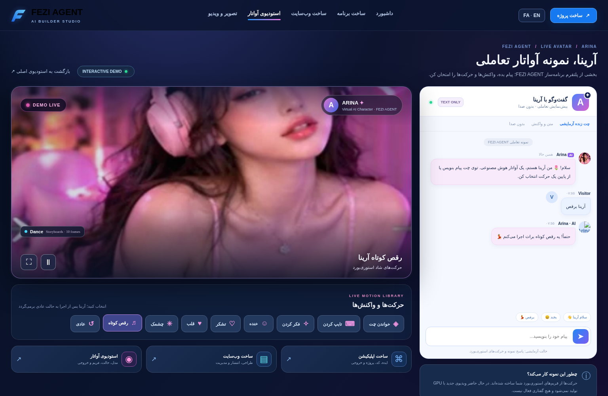
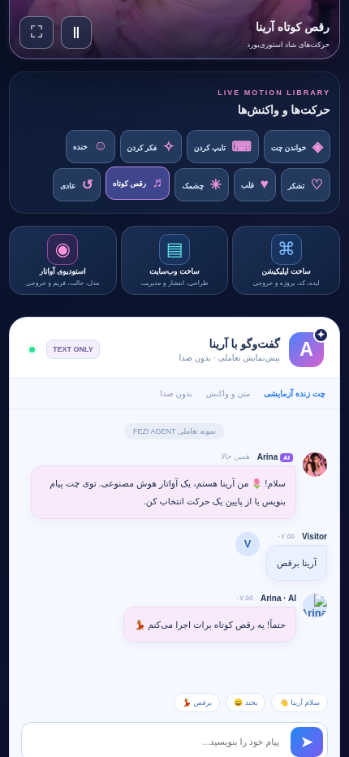

# FEZI Studio · آرینا

تصاویر از آرشیو پروژه هستند؛ تغییرات جدید در مرورگرِ هاست هنوز بررسی نشده‌اند.

## نصب سایت روی هاست
1. Node.js 22 را فعال کنید و محتوای بسته را در ریشه برنامه استخراج کنید.
2. npm install را اجرا کنید.
3. متغیرهای .env.example را در محیط امن هاست تنظیم کنید. APP_PASSWORD حداقل ۱۰ و SESSION_SECRET حداقل ۲۴ کاراکتر مستقل باشند.
4. ARINA_AI_ENABLED=true و ARINA_CHAT_PROVIDER=openai و OPENAI_API_KEY را تنظیم کنید.
5. npm start را اجرا کنید و دامنه HTTPS را به پورت برنامه متصل کنید. در cPanel فایل آغاز server.js است.
6. /arina-live/ را باز کنید، وارد حساب شوید، پیام بدهید و یک‌بار صفحه را لمس کنید تا موسیقی شروع شود.

## ربات‌های تلگرام
GitHub به‌تنهایی میزبان دائمی ربات نیست. سورس را روی سرور دارای worker اجرا کنید.
برای هر ربات توکن جداگانه از BotFather بگیرید؛ توکن‌ها فقط در متغیر محیط سرور قرار بگیرند.
سه بسته مستقل داخل standalone هستند: fezi، arina، fast-login؛ هرکدام .env.example و README خود را دارد.
در پوشه هر ربات: npm start. برای خواندن فایل env در Node 22: node --env-file=.env scripts/نام-اسکریپت.mjs؛ نام دقیق در package.json همان بسته است.
روی سرور دارای PM2 می‌توانید فایل ecosystem.config.cjs ریشه را اجرا کنید: pm2 start ecosystem.config.cjs سپس pm2 save. متغیرهای محیط باید از قبل در همان محیط تنظیم شده باشند.
برای یک توکن، فقط یک polling worker اجرا کنید. اجرای بسته مستقل و worker ریشه را همزمان برای یک توکن فعال نکنید.
هاست cPanel بدون worker دائمی ممکن است فقط سایت را اجرا کند؛ ربات‌ها را در آن حالت روی سرور دیگری اجرا کنید.

## GitHub
محتویات ZIP سورس را Extract و فایل‌ها را در ریشه مخزن آپلود کنید؛ خود ZIP را به‌جای سورس قرار ندهید.
.env و توکن و data و node_modules را آپلود نکنید. فقط .env.example قابل انتشار است.
Workflowهای بررسی و استقرار SSH در .github/workflows قرار دارند. برای استقرار، راهنمای HOST_AND_GITHUB_INSTALL_FA.md و workflow موجود را بخوانید و Secrets لازم را تنظیم کنید.
استقرار سایت و اجرای worker ربات دو مرحله جدا هستند؛ پس از استقرار، process manager سرور باید ربات‌ها را اجرا کند.

## وضعیت تحویل
دو حالت بیکاری، حالت تایپ، بلور گوشه لوگو و شخصیت فارسی آرینا اضافه شده‌اند.
پشتیبان‌ها: OpenAI، مسیریاب موجود، Ollama در صورت نصب و فعال‌سازی. اگر همه قطع باشند پیام روشنِ قطعی نمایش داده می‌شود.
کلیدها و توکن واقعی در این بسته قرار ندارند. استقرار، پرداخت، پاسخ سرویس واقعی و ورود تلگرام بدون تنظیمات شما تأیید نشده‌اند.
موسیقی داخلی فعال است؛ منابع رادیویی یافته‌شده به دلیل محدودیت استفاده عمومی خودکار فعال نشده‌اند.

## Visual identity
The supplied square icon is used for Chrome PWA installation and Android source launcher resources. The transparent FEZI Agent logo is used for the typing indicator and this README. Existing purple brand assets are preserved. Educational images appear between FAQ groups and at `/learn`. Android binaries must be rebuilt; this package contains source, not a newly signed APK.

## آرینا: ربات مستقل، لایو و کانال‌ها
دستور `/live` در ربات آرینا صفحهٔ مشترک `https://YOUR_DOMAIN/arina-live` را باز می‌کند. رادیو، گالری و چت همان نسخهٔ سایت‌اند؛ حساب انسانی جدید ساخته نشده است. برای اتصال کانال، راهنمای `ARINA_TELEGRAM_BOT_AND_CHANNEL_FA.md` و اسکریپت `npm run telegram:arina:channel` را ببین.

## نام رسمی
**FEZI Studio** نام پروژه است. نام Fedi Studio در بعضی بسته‌های قبلی یک نام‌گذاری اشتباه بوده و پروژهٔ جدید محسوب نمی‌شود.

## مرجع رسمی مأموریت FEZI Studio

- [پرامپت اصلی و بدون تغییر](docs/FEZI_STUDIO_MASTER_SPEC_FA.md)
- [خلاصه و حافظهٔ مرجع پروژه](docs/FEZI_MASTER_MEMORY_AND_STATUS_FA.md)
- `npm run master:check` برای ممیزی ایستای وضعیت، بدون چاپ کلیدها و بدون استقرار.
- `npm test` برای تست‌های رگرسیون. تست زندهٔ API، ربات و GitHub مجزا الزامی است.

